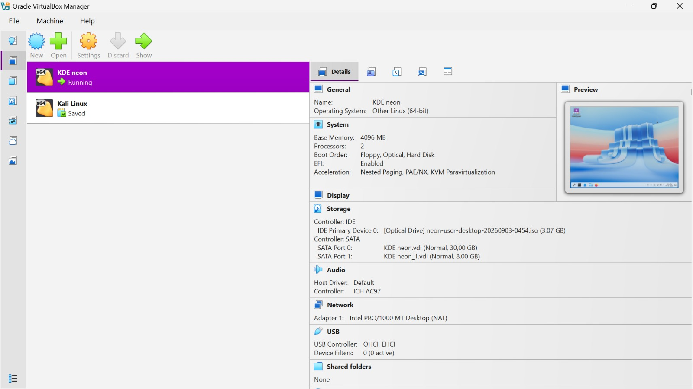
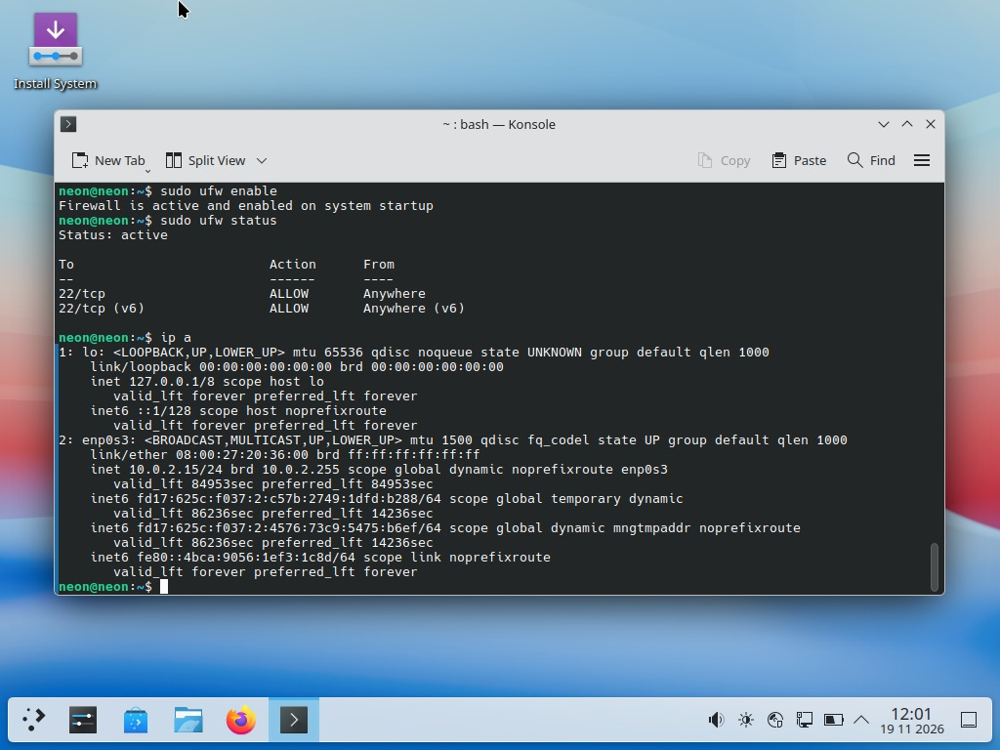
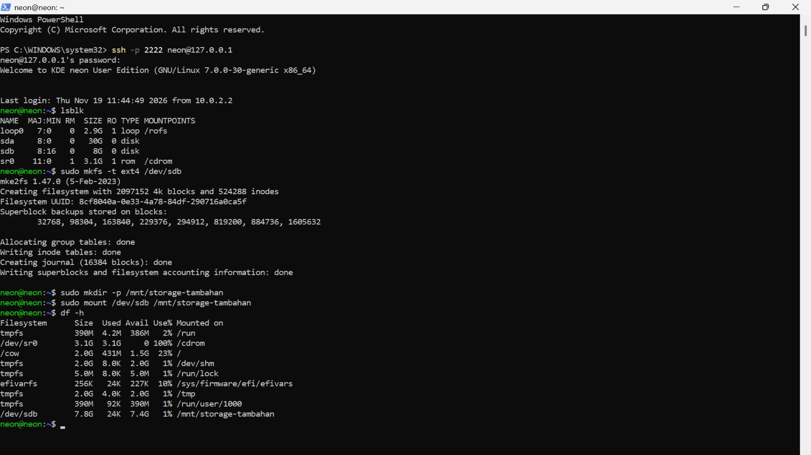

# Laporan Praktikum: Deployment VM & Penyimpanan Cloud

* **Nama:** Dodi Rohaedi
* **NIM:** 240131010
* **Mata Kuliah:** Komputasi Awan (Cloud Computing)
* **Lingkungan Praktikum:** Simulasi Infrastruktur Virtual (Oracle VirtualBox – KDE neon berbasis Ubuntu)

---

## 1. Pendaftaran & Persiapan Lingkungan VM
Praktikum dijalankan menggunakan lingkungan virtualisasi lokal **Oracle VirtualBox** sebagai simulasi infrastruktur IaaS (*Infrastructure as a Service*) karena keterbatasan metode verifikasi kartu pembayaran internasional pada pendaftaran akun *Free Tier* penyedia *cloud* publik. Seluruh tahapan inti mulai dari penyediaan VM Linux, penambahan *Block Storage*, konfigurasi *firewall* Port 22, hingga pengujian *Remote SSH* diterapkan secara penuh.

## 2. Penyediaan Instans VM
Instans mesin virtual (*Virtual Machine*) berbasis Linux dikonfigurasi dan diluncurkan dengan spesifikasi berikut:

| Parameter | Spesifikasi |
| :--- | :--- |
| **Nama Instans** | `KDE neon` |
| **Sistem Operasi** | KDE neon User Edition (berbasis Ubuntu 64-bit, Linux 7.0.0-30-generic x86_64) |
| **Alokasi Memori (RAM)** | `4096 MB` (4 GB) |
| **Prosesor (vCPU)** | `2 Processors` |
| **Penyimpanan Utama** | `30,00 GB` (`KDE neon.vdi` / `/dev/sda`) |
| **Jaringan & IP Instans** | NAT (`Intel PRO/1000 MT Desktop`), IP `10.0.2.15`, *Port Forwarding* Host `2222` ke Guest `22` |
| **Status Instans** | `Running` |

## 3. Konfigurasi Penyimpanan Tambahan (Block Storage)
Volume penyimpanan tambahan (*Virtual Disk / Block Storage*) sebesar **8,00 GB** (`KDE neon_1.vdi`, format VDI) dibuat dan dipasang (*attach*) pada *SATA Port 1* di VirtualBox. Setelah terdeteksi sebagai `/dev/sdb` di dalam sistem operasi Linux, disk diformat ke sistem file `ext4` dan di-*mount* ke direktori `/mnt/storage-tambahan`:

```bash
# 1. Memeriksa daftar disk yang terpasang (disk tambahan 8G terdeteksi sebagai /dev/sdb)
lsblk

# 2. Memformat disk tambahan ke sistem file ext4
sudo mkfs -t ext4 /dev/sdb

# 3. Membuat direktori mount point
sudo mkdir -p /mnt/storage-tambahan

# 4. Memasang (mount) disk tambahan ke direktori tujuan
sudo mount /dev/sdb /mnt/storage-tambahan

# 5. Memverifikasi penyimpanan tambahan berhasil terpasang
df -h
```

Hasil verifikasi `df -h` menunjukkan `/dev/sdb` terbaca dengan kapasitas `7.8G` (`7.4G` tersedia, terpakai `1%`) pada direktori `/mnt/storage-tambahan`.

## 4. Pengaturan Keamanan Jaringan (Firewall Port 22)
Layanan OpenSSH Server dan *firewall* UFW (*Uncomplicated Firewall*) diaktifkan untuk membuka akses trafik masuk (*inbound*) pada **Port 22 (TCP)** guna keperluan administrasi jarak jauh via SSH:

```bash
sudo apt update
sudo apt install openssh-server ufw -y
sudo systemctl enable --now ssh
sudo ufw allow 22/tcp
sudo ufw enable
sudo ufw status
```

| Layanan | Protokol | Port | Aksi | Sumber (*From*) |
| :--- | :--- | :--- | :--- | :--- |
| SSH | TCP | `22` | `ALLOW` | `Anywhere` |
| SSH (IPv6) | TCP | `22` | `ALLOW` | `Anywhere (v6)` |

## 5. Akses Jarak Jauh (Remote SSH)
Pengujian akses jarak jauh dilakukan dari terminal **Windows PowerShell** menuju instans VM Linux menggunakan kredensial akun `neon` melalui jalur *Port Forwarding* ke Port 22:

```bash
ssh -p 2222 neon@127.0.0.1
```

Autentikasi berhasil dilakukan dan sesi terminal interaktif instans VM (`neon@neon:~$`) dapat diakses dengan stabil.

## 6. Bukti Dokumentasi (Tangkapan Layar)

### a. Status VM *Running*, Spesifikasi Instans, dan Attach Block Storage (8 GB)


### b. Konfigurasi Firewall Port 22 dan Alamat IP Instans (`10.0.2.15`)


### c. Keberhasilan Login via SSH serta Format & Mount Block Storage (`/dev/sdb`)


## 7. Analisis Singkat

### Alasan Teknis Pemilihan Instance Type / Size
Pemilihan spesifikasi **2 vCPU**, memori **4096 MB (4 GB)**, dan sistem operasi Linux berbasis **Ubuntu 64-bit** disesuaikan agar lingkungan desktop KDE neon sekaligus layanan jaringan (OpenSSH Server dan UFW) serta pengelolaan *storage* dapat berjalan stabil tanpa mengalami kekurangan memori (*bottleneck*). Penambahan *Block Storage* sebesar **8,00 GB** dipilih karena efisien terhadap kapasitas penyimpanan komputer *host*, namun sudah memadai untuk praktik pemformatan sistem file `ext4` dan proses *mounting*.

### Alasan Teknis Pemilihan Region Cloud
Pada implementasi *cloud* publik bagi pengguna di Indonesia, pemilihan *region* terdekat seperti **Asia Pacific (Jakarta atau Singapore)** sangat penting untuk meminimalkan latensi jaringan (*round-trip time*) sehingga respons perintah terminal SSH tetap cepat dan stabil. Pada simulasi lokal menggunakan Oracle VirtualBox ini, infrastruktur berjalan langsung di mesin *host* sehingga latensi mendekati nol dan pengujian protokol keamanan serta penyimpanan dapat divalidasi secara akurat.
